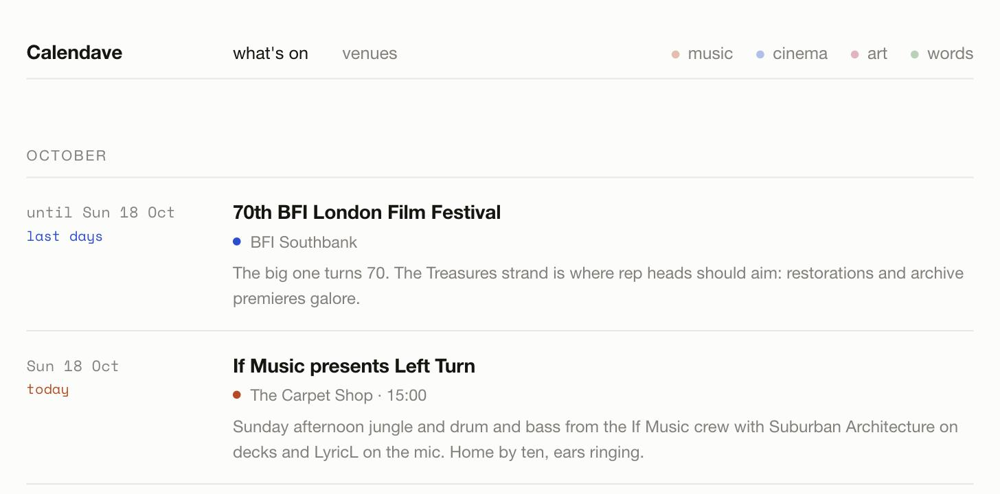

# Calendave

A personal radar for music, cinema, art and words, at places like Cafe OTO, the ICA and the Prince Charles Cinema.

**Live: [calendave.netlify.app](https://calendave.netlify.app)**



## How the listings stay fresh

There's no backend and no scraper. The listings are maintained by an agent on a schedule:

1. **Research.** [`.github/workflows/refresh-listings.yml`](.github/workflows/refresh-listings.yml) runs Monday, Wednesday and Friday mornings (or by hand from the Actions tab). It runs Claude Code with a written brief, [`.github/refresh-listings.md`](.github/refresh-listings.md): prune past events, check upcoming ones are still on, and research new ones venue by venue.
2. **Guardrails.** The brief sets the rules: only include events verified on a real page, never invent an event or a URL, keep a spread across music, cinema, art and words. The agent can only edit `data/`.
3. **Validate.** A Python check fails the run on duplicate ids, missing fields, unknown categories, bad dates or bad URLs.
4. **Build, then commit.** The site must build before anything is committed. Netlify redeploys on the push.

Past events also hide themselves at render time, so the site degrades gracefully if a run is missed.

The workflow needs a `CLAUDE_CODE_OAUTH_TOKEN` repo secret (create one with `claude setup-token`).

## Stack

Nuxt 3, statically generated. No backend, no tracking, no algorithm, just JSON.

## Data

All content lives in two files:

- `data/events.json`: the curated events. Each entry: `id`, `title`, `venue`, `scene` (`music` | `cinema` | `art` | `words`), `date` / `endDate` (ISO), `time`, `url`, `blurb`, `tags`, `price`.
- `data/venues.json`: the evergreen venue directory.

## Running it

```bash
npm install
npm run dev        # local dev at localhost:3000
npm run generate   # static build into .output/public
```

## Deploying

Import the repo into Netlify. It reads `netlify.toml` (build: `npm run generate`, publish: `.output/public`).

## Ideas for later

- Per-venue scrapers (Cafe OTO paginates `/events/?page=N`; The Cinema Museum runs WordPress + The Events Calendar, so `/events/?ical=1` may exist; several venues book through DICE) feeding `events.json` at build time.
- An `.ics` export so picks land in a real calendar.
- A "going" shortlist persisted in localStorage.

## License

MIT, see [LICENSE](LICENSE).
